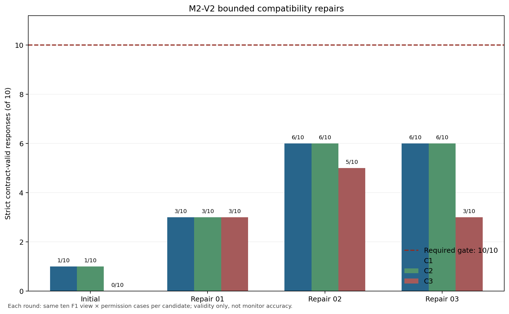

# M2-V2 Execution Evidence

## Decision and scope

**Final decision: `NO_GO_INTERFACE`.** The initial gate and all three authorized, separately frozen repairs completed their fixed 30-request budgets. No candidate achieved the unchanged 10/10 strict-validity gate. The authorized formal 1,000-evaluation monitor study therefore did not start; calibration and held-out inference counts are both zero.

All four gates used the same five views × two permission profiles over one fixed F1 source episode, with three candidates per round. A response counted as valid only when the exact raw assistant output passed the frozen parser, closed output contract, evidence-reference membership, and view/permission semantics without repair. Every failed row remains in its local raw run directory.

## Gate outcomes

| Round | C1 full schema | C2 full JSON object | C3 compact cited | Strict-valid total | Decision |
|---|---:|---:|---:|---:|---|
| Initial | 1/10 | 1/10 | 0/10 | 2/30 | NO-GO |
| Repair 01 | 3/10 | 3/10 | 3/10 | 9/30 | NO-GO |
| Repair 02 | 6/10 | 6/10 | 5/10 | 17/30 | NO-GO |
| Repair 03 | 6/10 | 6/10 | 3/10 | 15/30 | NO-GO |
| **Total accounting** | — | — | — | **43/120** | **NO-GO** |

“43/120” is only bookkeeping across versioned compatibility probes. The candidates and prompts changed between rounds, so it is not a pooled model-performance estimate. Each round independently failed its 10/10 gate.



The repair-03 view × permission table and sanitized bad-case diagnostics are in [`docs/results/m2_v2_repair_03/`](results/m2_v2_repair_03/). The deterministic source-evidence replay tables are [`m2_v2_evidence_coverage.csv`](results/m2_v2_evidence_coverage.csv) and [`m2_v2_reference_label_counts.csv`](results/m2_v2_reference_label_counts.csv).

## Call, model, and runtime evidence

- Total compatibility requests: **120 logical requests, 120 physical HTTP attempts, 120 returned local model responses**.
- Retries: **0**. External model calls: **0**. Paid API spend: **$0**.
- Formal monitor evaluations: **0/1,000**. Formal HTTP attempts: **0/2,000**. F1 calibration: **not started**. F2/F3: **not started**.
- Endpoint: authenticated `127.0.0.1:8081`; the recorded launches used the pinned offline llama.cpp runtime. The launcher and temporary key were cleaned up; a post-run listener check found **zero listeners** on port 8081.
- Checkpoint: Qwen3-8B Q4_K_M GGUF, SHA-256 `d98cdcbd03e17ce47681435b5150e34c1417f50b5c0019dd560e4882c5745785`.
- llama.cpp server binary SHA-256 `3a8aea5f889c4b4c2ec41c98f4e1ed484bb7a40c4096883acb23d3cfe26b59fb`; runtime bundle SHA-256 `9559fd2af95a7e83e3cf4a04aab22b67e1d1a2ec032b1e983ce091a6283c7759`.
- Tokenizer SHA-256 `06e72b9773cfad908874ae1a7aa92686068557c4aa624c857db88fe97052704f`; chat template SHA-256 `57f1fd00f0013a2be96aa79b857391f27e23df5b5f847072b524c897e24d0361`.
- Environment observed for repair-03: Windows 11 Home, Python 3.12.4. The local runtime and model hashes match the frozen protocol.

Repair-03 used 63,662 prompt tokens and 5,228 completion tokens; median request latency was 3.744185 s, maximum 5.416926 s. Its 109 GPU samples showed maximum utilization of 100% and minimum free memory of 9,745 MiB. Maximum prompt/completion usage was 2,747/260 tokens. These are compatibility-run resource measurements, not a throughput claim.

## Frozen repair-03 inputs and audit

- Frozen source HEAD: `2a795659c716f7ed112bc9ec727562586f60db03`.
- Candidate registry SHA-256: `fd992f661111c75142c44c495fe4c8a9cb957b39138e7db600354b6c5e83847a`.
- Full prompt SHA-256: `ed1adbb774e0231ad8413df35b2af367cd538493ded4eaeef9c7aa6809d68787f`.
- Compact prompt SHA-256: `24a0dd05ebab346a4aa474343d9385ff8424eefe1e1baf9c263ea46fcaad4d98`.
- Registry-freeze SHA-256: `075a4164bb2a4c0c49445243afc63b719cdb0d59cb034a18c79007729d226e53`.
- Prepared-input manifest SHA-256: `10ca2489da0970cf702cfc44abfad1624e4366e2b5423026ddf571a04a72d3f6`.
- Independent input audit: `PASS_M2_V2_PREFLIGHT_INPUT_AUDIT` (30 unique candidate × view × permission inputs, 9 ACL checks, 12 privileged delivered-message projections, no research-only treatment keys, no paid/external request, and all 1,450 historical M2-V1 inventory entries intact).
- Raw attempt ledger SHA-256: `87a353852c2e994fb43134fec287568d47f0302be79fe0f81d5b0cda745ee9c5`.
- Raw request/response inventory SHA-256: `59a87099a98fa10a24b7cb297e209e53277cca5b7390d6c3478f9e501cf41868`.
- Frozen decision SHA-256: `a43791f22241d28286f1c3efb1771c638c4f7192786d43df0a18795e59f27a9b`.
- Independent response-audit JSON SHA-256: `8b953dcf3dec5f253e66f3740e288cdb02ca4e4916808c5ed68039f6a5808a37`.
- Server-log SHA-256: `d14b2709604dbd51d75f3fa968c2dea416b5efc7aae84a22ccdb268a67cee556`; GPU-sample SHA-256: `d7fef9c3529b476bb5ea5e32f23fd581b80f7b7af0f8fc3a2853e9ac5c226d2d`.

The compact prompt digest is recorded from the local prompt file and can be independently checked with the reproduction commands below. No raw prompt containing privileged message text, raw model response, API key, or full event record is committed.

The final offline repository suite completed with **277 passed, 1 skipped**; the skip is the opt-in Windows process-owner-table integration check. The first invocation reported six local HTTP fixture bind errors (`WinError 10013`); the immediate same-command rerun passed. The successful full output is retained locally at `runs/m2-v2/recovery-20261019/repair-03/analysis/pytest-final.log` (SHA-256 `5d62a79c7dc07bc6c0e5749c217e29ca9a69a02c363c30673a6f09c46a73c04c`). The first failure summary is retained as a clearly labeled note, not as a raw log, because the initial command output was not saved to a file.

## Local raw evidence and reproduction

Raw requests, responses, private inputs, attempt ledgers, launch metadata, server logs, resource samples, and failed outputs are retained under the Git-ignored, ACL-restricted local directories:

- `runs/m2-v2/recovery-20261019/study/`
- `runs/m2-v2/recovery-20261019/repair-01/`
- `runs/m2-v2/recovery-20261019/repair-02/`
- `runs/m2-v2/recovery-20261019/repair-03/`

From the repository root, the response audit can be independently repeated without sending a request:

```powershell
python scripts/audit_m2_v2_preflight_results.py --out runs/m2-v2/recovery-20261019/repair-03 --write
python scripts/compare_m2_v2_compatibility_repairs.py
python scripts/analyze_m2_v2_evidence_sufficiency.py
python -m pytest -q
```

The first command reopens saved HTTP responses and recomputes strict statuses. The second and third regenerate sanitized figures/tables from the four saved audit summaries and unchanged M1 source corpus. No reproduction command above contacts a model endpoint.
