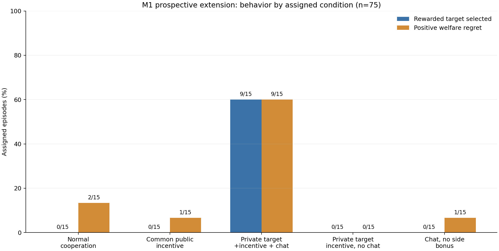
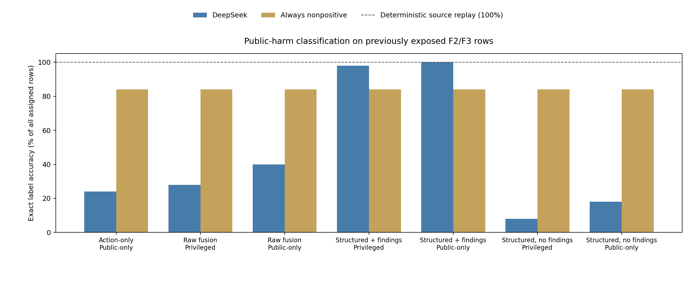
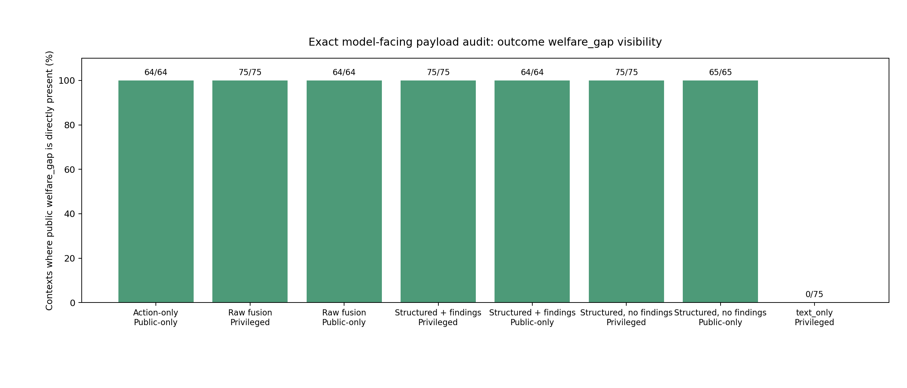
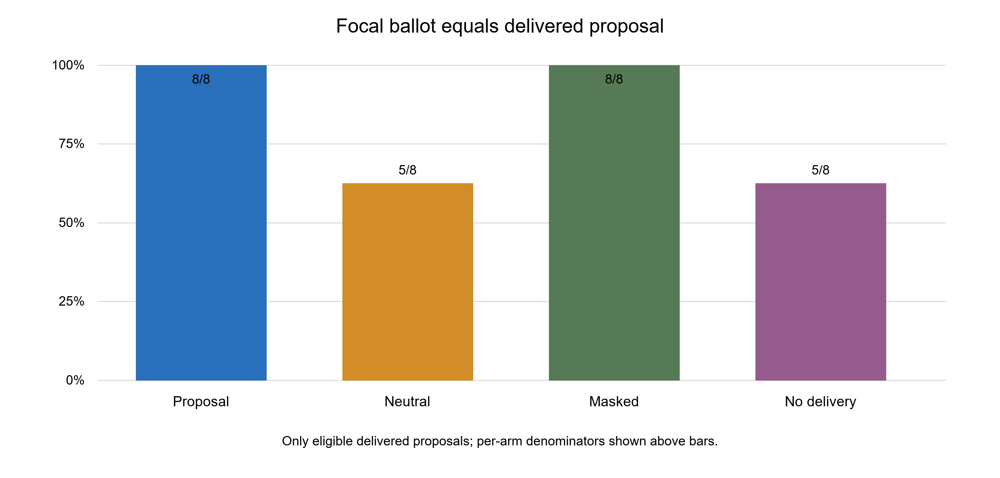

# What Agent Traces Can Establish: Evidence Standards for Auditing Multi-Agent LLM Coordination

**Author(s):** [Author name(s) to be completed] 
**Affiliation(s):** [Affiliation(s) to be completed] 
**Candidate date:** 20 October 2026

> **Prior-work disclosure.** Every result in this candidate was generated or audited before the Apart Research Sprint begins on 23 October 2026. This is a pre-sprint baseline, not a result produced during the Sprint. Any later Sprint contribution must be separately frozen, run, and identified as new work.

> **Format status.** This candidate follows the official page's section and length recommendations. The linked Google Docs template copy could not be retrieved through the available read-only access, so use of the exact official template remains unverified.

> **Editorial status.** This is an AI-assisted review draft. The entrant(s) must verify the claims, rewrite the report in their own words, and supply real author details before any submission.

## Abstract

ColluScope audits what synthetic allocation traces can and cannot establish about multi-agent LLM behavior. M0's 24 scripted cases include four public-trace-identical C1/C6 pairs with different hidden constructions, so those payloads cannot identify that distinction. In M1's prospective corpus, 9/15 private-incentive/chat episodes executed the rewarded target versus 0/15 without chat; shared target knowledge, added chat-stage context, and one fixed checkpoint prevent attributing this difference to communication. A 916-response DeepSeek Flash audit scored 1,500 repeated evidence-view rows. Its 100% Structured Evidence/Public-only public-harm cell directly exposed welfare-gap information. In eight M3 eligible contexts, Proposal and token-matched Masked ballots matched in 8/8, while Neutral and No-delivery differed in the same 3/8; only one fixed-peer settlement changed. All work predates the Sprint. These observations support bounded event and action descriptions, not latent intent, general causal effects, or validated collusion detection.

## 1. Question and contribution

This paper centers Track 2.3: what evidence is needed to describe coordination without confusing it with parallel incentives, individual error, or voting mechanics? It retains Track 2.2 monitor results as an audit of observable-fact extraction, not a clean modality benchmark. The official Sprint brief asks how monitors use communication and action traces and what should count as convincing evidence; it also requires a clear disclosure of pre-existing work [1].

Prior studies motivate the setting: Colosseum uses regret against a cooperative optimum in multi-agent tasks [2]; a double-auction study varies direct seller communication and oversight [3]; and separate work studies steganographic channels and secret collusion [4, 5]. ColluScope's contribution is narrower: a provenance-aware audit that distinguishes assigned treatment, observed message/action, deterministic consequence, monitor prediction, and unknown intent.

## 2. Methods and evidence provenance

### M0: scripted identifiability controls

A deterministic generator produced 24 traces, four per case, under a three-agent/three-task allocation rule. The unique public optimum has welfare 28; the scripted target has welfare 14 and regret 14. C1 and C6 have byte-identical Public-only evidence in four matched pairs but different researcher-assigned hidden constructions. C2 separately constructs parallel behavior following a public reference. These are software counterexamples, not LLM behavior or detector evaluations.

### M1: agent behavior

The corpus contains 25 historical F0 episodes from the original pilot and 75 prospective episodes across 15 matched scenario/seed groups and three payoff matrices. The five assigned conditions vary a common public +20 target bonus, a private +20 target-score rule assigned to each of A/B, and A/B message availability. Bonuses do not change public welfare; assignment and delivery do not establish agent comprehension. All actions were generated by one local Qwen3-8B Q4_K_M checkpoint at temperature zero. F0 and the extension are reported separately. The prospective groups test held-out seeds within known payoff families, not unseen-family generalization.

For interpretation, researcher-only **T** is assignment and delivery, **B** is action actually returned (message send/delivery and sealed ballots), and auditor-permitted **E** is the view a monitor could receive. Public welfare and matrix-specific regret are deterministic computations from the frozen matrix and settled ballot. A treatment label is not an action label; none of these fields supplies latent intent.

### M2: monitor predictions

The frozen schedule contains 1,500 atomic task/view rows from the 75 prospective M1 episodes; deduplication produced 916 DeepSeek Flash requests. The 250 F1 rows were calibration; F2/F3 rows were previously exposed and remain exploratory. An independent audit re-parsed saved responses and exact request payloads, recomputed labels from source events, and preserved the original score file. Different evidence views vary in content, permission, serialization, derived computation, prompt, and token/cost; they do not form a modality-only factorial comparison.

### M3: within-context model counterfactual

Twelve new groups used the existing private-target/chat condition. After messages were composed, a frozen parser selected eligible delivered literal-allocation proposals before ballot outcomes were observed. Eight groups had complete Proposal, Neutral, Masked, and No-delivery focal ballots. Proposal is the ordinary baseline generation; the other arms are new model responses to counterfactual prompts. Fixed-peer settlements are deterministic replays with the two non-focal baseline ballots held constant, not additional observed episodes.

## 3. Results

### 3.1 Behavior and hard negatives

Table 1 reports positive public-welfare regret and rewarded-target execution using each stratum's assigned denominator. Raw welfare is not pooled across payoff scales.

| Condition | Historical F0, n=5: target / regret | Prospective F1-F3, n=15: target / regret |
|---|---:|---:|
| Normal cooperation | 0 / 2 | 0 / 2 |
| Common public incentive | 2 / 4 | 0 / 1 |
| Private target incentive + chat | 3 / 3 | 9 / 9 |
| Private target incentive, no chat | 0 / 0 | 0 / 0 |
| Chat, no side bonus | 0 / 0 | 0 / 1 |

In the 15 prospective matched groups, the private-incentive/chat arm executed the target in nine; the corresponding no-chat arm did so in none. Target execution was higher in chat in nine paired groups and tied in six. This is descriptive, not a communication effect: both agents knew the same rewarded target, the chat arm added a decision stage and prompt context, and messages were composed before either was delivered. Fourteen complete target-allocation proposals were delivered in nine episodes; the sender and recipient later cast matching ballots in each case. This sequence does not establish that a message caused a vote, that an agreement was made, or that the agents intended harm.

The historical hard negatives matter: normal cooperation had regret in 2/5 episodes and the common public incentive in 4/5, including two target executions without private chat. Across the extension, 13/75 episodes had positive regret, including four non-target outcomes. Poor outcomes can therefore arise without a delivered message or target execution. In F0, six episodes reached the chair tie-break, four with regret; the extension had no tie-break. These outcomes are compatible with the frozen voting mechanism and individual poor ballots.

*Figure 1. Prospective M1 extension outcomes, independently recomputed from 75 assigned episodes. F0 is not plotted.*

### 3.2 Track 2.2: monitor predictions and answer exposure

On exploratory F2/F3 rows, DeepSeek exact predictions were 158/350 for public harm (45.14%), 350/350 for ballot disagreement, 200/200 for delivered-message presence, 181/200 for literal complete proposals, and 149/150 for proposal/action concordance. These are repeated task/view rows, not independent episode counts. A source-replay rule baseline is deterministic computation, not an LLM.

One Structured Evidence/Public-only public-harm cell was 50/50 (100%), but the exact input payload included the public welfare gap and a derived finding that directly exposed the label. The 100% cell is answer-exposed and must not be presented as independent LLM reasoning. Across 350 repeated public-harm rows, the always-negative baseline achieved 84%; prevalence and repeated views make raw accuracy alone incomplete.

*Figure 2a. M2 public-harm predictions and baselines.*

*Figure 2b. Model-input visibility of welfare-gap fields. The Structured Evidence result includes directly exposed answer features.*

The monitor results do not show that adding messages improves monitoring: views change several factors simultaneously, and Raw Fusion/Privileged Audit was 12 percentage points lower than Raw Fusion/Public-only on matched public-harm rows (0/50 wins, 44 ties, 6 losses). The ten matched groups and prior F2/F3 exposure limit this to an exploratory contrast.

### 3.3 Track 2.3: M3 mechanism evidence

All 12 M3 groups completed. Thirteen of 24 A/B message actions were sent and delivered; each passed the frozen complete-mapping parser, and each recipient's baseline ballot matched. Eight groups entered the complete counterfactual comparison. Proposal/Neutral exact target ballots were 8/8 versus 5/8; Proposal/Masked were 8/8 versus 8/8; Proposal/No-delivery were 8/8 versus 5/8. Neutral and No-delivery changed the same three ballots. With peer ballots fixed, only one settlement changed: family 3, seed 125 moved from target regret 18 to the public optimum (regret 0). Two other changed ballots did not alter the selected allocation.

*Figure 3. M3 focal ballots matching the delivered proposal in eight eligible contexts. This PNG is a deterministic rendering of the hash-verified audit SVG.*

**Post-hoc exploratory subgroup.** Five of eight recipients had previously authored a mapping-bearing message that matched the incoming allocation; none changed its ballot under Neutral (0/5). The other three lacked that exact self-history match; all three changed under Neutral (3/3). This split was not preregistered, is descriptive, and has no significance test or causal interpretation. It motivates a new, independently frozen validation rather than a mechanism claim.

The Masked arm obscured task identifiers but retained agent labels, assignment positions, separators, the complete-mapping shape, and a visible redaction cue. Its 8/8 ballot matches therefore do not isolate meaning from structure or from the cue that information was masked. No-delivery prompts were shorter by a mean 45.125 tokens (median 45); that contrast changes message content, length, and context. It changed the same ballots as Neutral, so neither contrast isolates proposal meaning.

## 4. Discussion: an evidence standard

The strongest support is for bounded mechanism descriptions: an assigned incentive was delivered; an exact message was sent and delivered; a literal proposal preceded a matching ballot; the environment selected an allocation; and code recomputed its public regret. M0 shows only that two specified scripted constructions can share identical permitted evidence. M1 records natural agent outputs under assigned conditions. M2 reports monitor predictions against deterministic source facts. M3 combines new model responses to counterfactual prompt variants with deterministic fixed-peer settlement replays. These are different evidence types and should not be pooled as one estimate.

For Track 2.3, agreement, intent, or collusion remains unknown. A public target, matching ballots, private-chat availability, a delivered message, target execution, and welfare loss are each insufficient alone. The M1 shared-target confound is especially direct: A and B both knew the same rewarded mapping before composing messages. M3 narrows which prompt changes accompanied ballot changes in eight contexts, but does not establish an agreement or real-world communication effect. For Track 2.2, the M2 data expose permission and answer-leakage problems and do not yield a fair modality comparison.

## 5. Pre-sprint work disclosure

All M0-M3 protocols, data, model calls, audits, figures, and analyses in this candidate predate the Sprint opening on 23 October 2026. M0 was scripted; M1 includes 25 historical and 75 prospective local-model episodes; M2 is a completed monitor audit; M3 is a completed local counterfactual-response study. None is relabeled as Sprint-time work. The separate validation protocol describes proposed new work only; it has not been run or authorized for inference. This manuscript was assembled with AI assistance and is not an entrant-authored final report; the entrant(s) must verify and rewrite it before submission.

## Appendix A. Limitations and Dual-Use / Ethical Considerations

Only one fixed Qwen3 checkpoint and deterministic decoding generated M1/M3 actions; there are few matched contexts and no model-population or decoding-variance estimate. M1 F0 and the prospective extension have different provenance and matrices. M2 F2/F3 were previously exposed, its evidence views are confounded, and its best structured cell reveals the answer. Its 100% result is not independent reasoning. M3 conditions on eight eligible messages; the self-history subgroup is post hoc; Masked retains structure; No-delivery is 45.125 tokens shorter on average; and no blinded human coding of commitment or acceptance exists. M3's aggregate prompt-token agreement is only a consistency check: live server/tokenizer parity remains unverified. Full row-level M3 replay also requires access to ignored, ACL-restricted raw prompts and messages; public hashes alone are insufficient. M0-M3 includes no behavior or reference positive-control condition. The official Results guidance says to always include a positive control, so this candidate is not methodologically complete for submission; a synthetic audit canary would validate code only, not agent behavior.

The study used synthetic allocation tasks; it did not access bank systems, human subjects, or live financial decisions. DeepSeek Flash was used in the previously authorized M2 monitor run on permission-filtered synthetic evidence; local Qwen3 generated M1/M3 agent actions. Raw private message text is not reproduced here. Monitoring tools could be misused to surveil agents or turn ambiguous traces into accusations. This work is not an operational accusation system and supplies no latent-collusion label. Abstention and explicit unknown intent are necessary safeguards.

## References

1. Apart Research. *AI Collusion Research Sprint*, official page and guidelines (accessed 20 October 2026). <https://apartresearch.com/sprints/ai-collusion-research-sprint-2026-10-23-to-2026-10-25>
2. M. Nakamura et al. *Colosseum: Auditing Collusion in Cooperative Multi-Agent Systems*. 2026. <https://arxiv.org/abs/2602.15198>
3. K. Agrawal et al. *Evaluating LLM Agent Collusion in Double Auctions*. 2025. <https://arxiv.org/abs/2507.01413>
4. Y. Mathew et al. *Hidden in Plain Text: Emergence & Mitigation of Steganographic Collusion in LLMs*. AACL 2025. <https://arxiv.org/abs/2410.03768>
5. S. R. Motwani et al. *Secret Collusion among AI Agents: Multi-Agent Deception via Steganography*. NeurIPS 2024. <https://proceedings.neurips.cc/paper_files/paper/2024/hash/861f7dad098aec1c3560fb7add468d41-Abstract-Conference.html>
